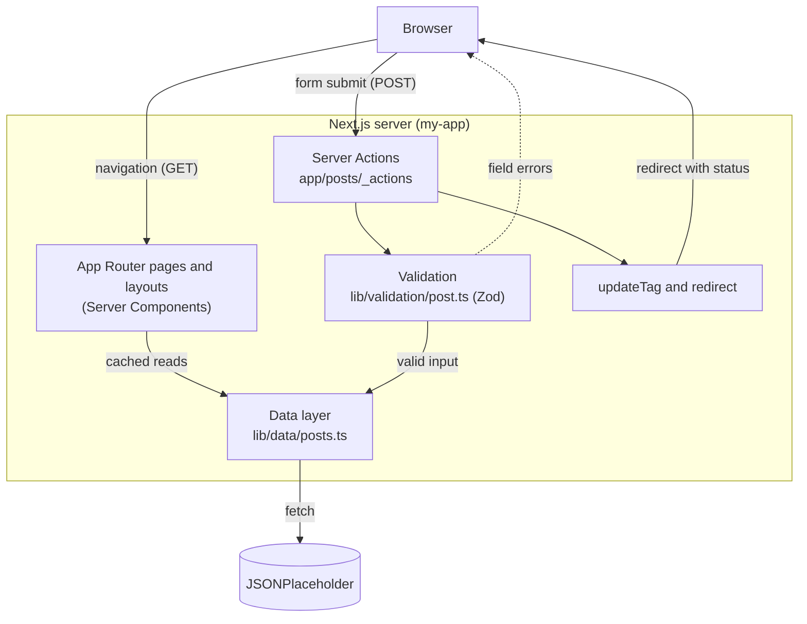
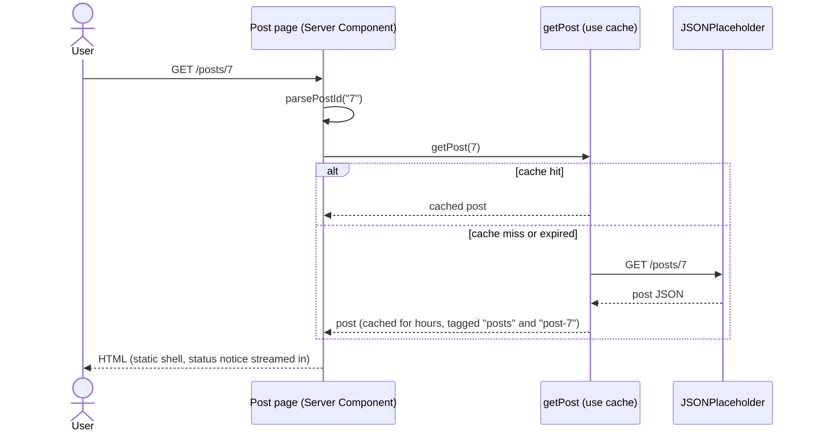
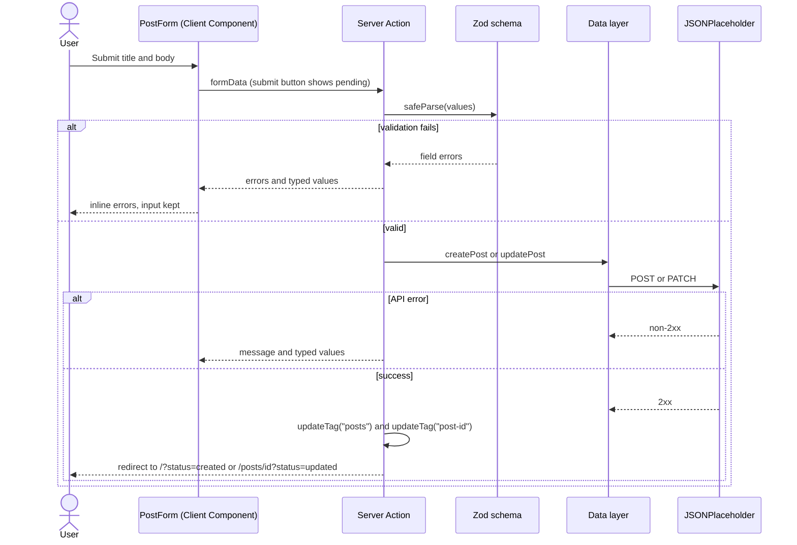
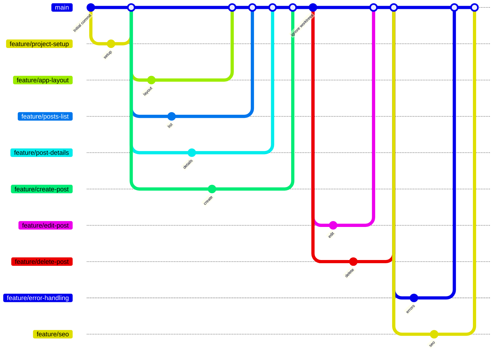

# Content-Driven Blog

> A production-style blog built with Next.js 16 and the App Router, powered entirely by a public REST API, with no custom backend.


## Table of contents

- [Overview](#overview)
- [Features](#features)
- [Tech stack](#tech-stack)
- [Architecture](#architecture)
- [Data flow](#data-flow)
- [Server vs Client Components](#server-vs-client-components)
- [Caching and revalidation](#caching-and-revalidation)
- [Routes](#routes)
- [Project structure](#project-structure)
- [Getting started](#getting-started)
- [Scripts](#scripts)
- [Environment variables](#environment-variables)
- [API limitations and design decisions](#api-limitations-and-design-decisions)
- [Git workflow](#git-workflow)
- [What I learned](#what-i-learned)
- [Author](#author)
- [License](#license)

## Overview

Content-Driven Blog is a learning project. Its goal is to practise a production-style Next.js architecture (Server Components by default, a single data layer, Server Actions for writes, server-side validation, explicit caching, proper error boundaries and SEO) without having to build or host a backend.

The only data source is [JSONPlaceholder](https://jsonplaceholder.typicode.com), a free fake REST API. There is no custom backend, no database and no client-side data-fetching library: every request to the API is made on the server, from one module.

## Features

**Reading**
- Home page listing all 100 posts as cards.
- Post details page at `/posts/[id]`, with every id prerendered at build time.
- Status notices after create, update and delete (`?status=created|updated|deleted`).

**Writing (CRUD via Server Actions)**
- Create a post, edit a post (prefilled form) and delete a post.
- All writes go through Server Actions in `app/posts/_actions/`.
- Server-side validation with Zod; the id of edit and delete is re-validated on the server.

**UX and accessibility**
- Pending states on every submit button (`useFormStatus`) and on the delete button.
- Field-level error messages linked to inputs with `aria-invalid` / `aria-describedby`; typed values are kept when validation fails.
- Visible focus rings (`focus-visible`) on links and buttons.
- Dark mode through `prefers-color-scheme`.
- `window.confirm` before deleting a post.
- A loading skeleton with `role="status"` text for screen readers.

**Error handling**
- `error.tsx` for route errors, with a retry button and an error reference (digest) when available.
- `global-error.tsx` for crashes of the root layout.
- `not-found.tsx` for unknown routes and for unknown or invalid post ids.
- `loading.tsx` as an automatic Suspense boundary.
- A typed `ApiError` thrown by the data layer.

**SEO**
- Title template (`%s | Content-Driven Blog`) and `metadataBase`.
- Per-post `generateMetadata`: title, description, canonical URL and an OpenGraph `article`.
- `noindex` on the create and edit pages.
- `robots.txt` and `sitemap.xml` generated in code.

## Tech stack

| Technology | Version | Used for |
| --- | --- | --- |
| [Next.js](https://nextjs.org) | 16.4.3 | App Router, Server Components, Server Actions, Turbopack, Cache Components |
| [React](https://react.dev) | 19.3.0 | UI, `useActionState`, `useFormStatus` |
| [TypeScript](https://www.typescriptlang.org) | 5.9.3 (`^5`, strict) | Type safety |
| [Tailwind CSS](https://tailwindcss.com) | 4.3.3 (via `@tailwindcss/postcss`) | Styling and dark mode |
| [Zod](https://zod.dev) | 4.6.7 | Input validation and field errors |
| [ESLint](https://eslint.org) | 9.39.5 with `eslint-config-next` 16.4.3 | Linting |
| [JSONPlaceholder](https://jsonplaceholder.typicode.com) | n/a | The only data source |

Next.js 16 requires Node.js 20.9 or newer. The project was developed on Node 26 with npm 12.

## Architecture



| Layer | Location | Responsibility |
| --- | --- | --- |
| Routes and boundaries | `app/` | Pages, layouts, `loading`, `error`, `global-error`, `not-found`, `robots`, `sitemap`. Server Components unless marked otherwise. |
| Server Actions | `app/posts/_actions/` | Create, update and delete. A private folder (prefixed with `_`), so it is not a route. |
| Components | `components/` | `layout/` (header, footer), `posts/` (card, list, form, notice, delete button) and `ui/` (submit button). |
| Data layer | `lib/data/posts.ts` | The only module that calls the API. It is `server-only`, caches reads, throws `ApiError`, and uses `PATCH` (never `PUT`) for updates. |
| Validation | `lib/validation/post.ts` | Zod schemas for title and body, plus `parsePostId` (accepts 1 to 100 only). |
| Site config | `lib/site.ts` | `SITE_NAME` and `SITE_URL`. |
| Types | `types/post.ts` | `Post`, input types inferred from Zod, and `ActionState`. |

## Data flow

### Reading a post (cached)



### Creating or editing a post



Edit and delete receive the post id through `.bind(null, id)`. Because bound arguments come from the client, the id is validated again on the server. (Create only calls `updateTag("posts")`; edit and delete also expire the single-post tag.)

## Server vs Client Components

Everything is a Server Component unless the browser is required. The Client Components are:

| Component | File | Why it needs the browser |
| --- | --- | --- |
| `PostForm` | `components/posts/post-form.tsx` | Uses `useActionState` to hold the action result (field errors and typed values). |
| `SubmitButton` | `components/ui/submit-button.tsx` | Uses `useFormStatus` to show a pending state. |
| `DeletePostButton` | `components/posts/delete-post-button.tsx` | Uses `window.confirm` and `onSubmit`, plus `useFormStatus`. Kept tiny so the post page stays a Server Component. Without JavaScript the form still submits, only without the confirmation. |
| `ErrorPage` | `app/error.tsx` | Error boundaries must be Client Components; it also has an `onClick` retry and a `useEffect` for logging. |
| `GlobalError` | `app/global-error.tsx` | Same requirement; it replaces the root layout, so it renders its own `<html>` and `<body>`. |

## Caching and revalidation

- **`'use cache'`**: `getPosts` and `getPost` in `lib/data/posts.ts` are cached functions. Cache Components is enabled with `cacheComponents: true` in `next.config.ts`.
- **`cacheLife('hours')`**: cached reads are kept for the `hours` profile before they are revalidated.
- **`cacheTag`**: `getPosts` is tagged `posts`; `getPost` is tagged `posts` and `post-<id>`.
- **`updateTag`**: after a successful write, Server Actions call `updateTag("posts")` (and `updateTag("post-<id>")` for edit and delete) so the next read is fresh. This is correct in principle, but JSONPlaceholder never persists writes, so the data does not actually change (see below).
- **Static shell and dynamic hole (◐)**: pages are prerendered into a static shell. The only request-time part is `StatusNotice`, which reads `searchParams` inside a `<Suspense>` boundary. `partialPrefetching: true` is also enabled in `next.config.ts`.
- **`generateStaticParams`**: `/posts/[id]` and `/posts/[id]/edit` prerender all 100 ids from `getPosts()`.

## Routes

| Path | Rendering | Description |
| --- | --- | --- |
| `/` | Partial prerender (◐) | Posts list. The status notice is a dynamic hole inside Suspense. |
| `/posts/[id]` | Partial prerender (◐), 100 ids from `generateStaticParams` | Post details with edit and delete actions. |
| `/posts/[id]/edit` | Prerendered ids, `noindex` | Edit form prefilled with the post. |
| `/posts/create` | Static, `noindex` | Create form. |
| `/robots.txt` | Generated from `app/robots.ts` | Allows `/`, disallows `/posts/create` and `/posts/*/edit`, links the sitemap. |
| `/sitemap.xml` | Generated from `app/sitemap.ts` | 101 URLs: the home page and the 100 posts. |
| Boundaries | n/a | `not-found`, `error`, `global-error` and `loading`. |

## Project structure

```text
my-app/
├── app/
│   ├── layout.tsx              Root layout: fonts, header, footer, metadata template
│   ├── page.tsx                Home: posts list and status notice
│   ├── globals.css             Tailwind import and light/dark theme variables
│   ├── loading.tsx             Skeleton shown while pages load
│   ├── error.tsx               Route error boundary (Client Component)
│   ├── global-error.tsx        Root layout error boundary (Client Component)
│   ├── not-found.tsx           404 page
│   ├── robots.ts               robots.txt generator
│   ├── sitemap.ts              sitemap.xml generator
│   ├── favicon.ico
│   └── posts/
│       ├── [id]/
│       │   ├── page.tsx        Post details, generateStaticParams and generateMetadata
│       │   └── edit/page.tsx   Edit page (noindex)
│       ├── create/page.tsx     Create page (noindex)
│       └── _actions/           Private folder, not a route
│           ├── create-post.ts  Server Action: create
│           ├── update-post.ts  Server Action: update
│           └── delete-post.ts  Server Action: delete
├── components/
│   ├── layout/
│   │   ├── site-header.tsx
│   │   └── site-footer.tsx
│   ├── posts/
│   │   ├── post-card.tsx
│   │   ├── post-list.tsx
│   │   ├── post-form.tsx           Client Component
│   │   ├── status-notice.tsx
│   │   └── delete-post-button.tsx  Client Component
│   └── ui/
│       └── submit-button.tsx       Client Component
├── lib/
│   ├── data/posts.ts           The only module that calls the API (server-only)
│   ├── validation/post.ts      Zod schemas and parsePostId
│   └── site.ts                 SITE_NAME and SITE_URL
├── types/post.ts               Post, input types, ActionState
├── next.config.ts              cacheComponents, partialPrefetching, turbopack root
├── postcss.config.mjs          @tailwindcss/postcss
├── eslint.config.mjs           eslint-config-next (core-web-vitals and TypeScript)
├── tsconfig.json
└── package.json
```

## Getting started

**Prerequisites:** Node.js 20.9 or newer, npm, and internet access (the build fetches from JSONPlaceholder).

```bash
git clone https://github.com/TheManana11/content-driven-blog.git
cd content-driven-blog/my-app
npm install
npm run dev
```

Open <http://localhost:3000>.

To build and run in production mode:

```bash
npm run build
npm run start
```

On a fresh clone, run `npx next typegen` before `npx tsc --noEmit`. The route types (`PageProps`, `LayoutProps`) are generated by Next.js and are not committed.

## Scripts

Run these from `my-app/`.

| Script | Command | Description |
| --- | --- | --- |
| `npm run dev` | `next dev` | Start the development server. |
| `npm run build` | `next build` | Create a production build. Needs network access. |
| `npm run start` | `next start` | Serve the production build. |
| `npm run lint` | `eslint` | Lint the project. |

## Environment variables

| Variable | Required | Default | Description |
| --- | --- | --- | --- |
| `NEXT_PUBLIC_SITE_URL` | No | `http://localhost:3000` | Public base URL used for `metadataBase`, canonical URLs, `robots.txt` and the sitemap. Set it when deploying, for example `https://myblog.com`. It is public by design: it is a URL, not a secret. |

Put it in `my-app/.env.local` (`.env*` files are git-ignored).

## API limitations and design decisions

JSONPlaceholder is a fake API, and the app is built to be honest about that:

- **Writes are simulated and never persisted.** POST, PATCH and DELETE return success, but the data never changes.
- **A created post gets id 101**, which cannot be viewed, so creating redirects to `/` rather than to the new post.
- **Edit and delete "succeed" without any visible change.** The UI shows "simulated" notices so this is not confusing.
- **The API accepts anything**, so all validation (title 3 to 100 characters, content 10 to 2000, ids 1 to 100) lives in this project.
- **Building needs network access**, because `generateStaticParams` fetches the post list.
- **The data layer is the only place that knows the API.** It uses `PATCH` for updates, throws `ApiError`, and treats a 404 on a single post as `null`, which becomes `notFound()`.
- **Known behaviour for unknown post ids:** the first request after a server start returns status 200 with the not-found UI and `noindex`; later requests return 404. This is documented Next.js streaming behaviour (see the "Status codes" section of `loading.md` in the Next.js docs).

## Git workflow

Each feature was developed on its own branch and merged into `main` with `--no-ff`, so the history keeps every feature visible. Branches within the same wave were built in parallel from the same `main` commit and merged one after another.

| Wave | Branches |
| --- | --- |
| 1. Setup | `feature/project-setup` |
| 2. Core pages | `feature/app-layout`, `feature/posts-list`, `feature/post-details`, `feature/create-post` |
| 3. Edit and delete | `feature/edit-post`, `feature/delete-post` |
| 4. Errors and SEO | `feature/error-handling`, `feature/seo` |



## What I learned

- Using the App Router with Server Components by default, and pushing `"use client"` down to small leaves only when the browser is needed.
- Keeping all API access in one `server-only` data layer with typed errors.
- Caching with `'use cache'`, `cacheLife` and `cacheTag`, and expiring data with `updateTag` after mutations.
- Partial prerendering: a static shell with a dynamic hole wrapped in `<Suspense>`.
- Writing Server Actions with `useActionState`, `useFormStatus`, `.bind` for arguments and `redirect` after success.
- Treating Server Actions as public endpoints: validate everything with Zod on the server, including bound ids.
- Building error boundaries (`error`, `global-error`, `not-found`, `loading`) and understanding their status-code behaviour.
- Static generation of dynamic routes with `generateStaticParams`.
- Metadata for SEO: title templates, `generateMetadata`, canonical URLs, `robots.ts` and `sitemap.ts`.
- Working with a limited API honestly, by surfacing its limitations in the UI instead of hiding them.

## Author

**Ahmad Manana**

GitHub: [TheManana11](https://github.com/TheManana11)

Feedback, questions and suggestions are very welcome. Feel free to open an [issue](https://github.com/TheManana11/content-driven-blog/issues) on GitHub.

## License

No license specified yet — all rights reserved by the author.
